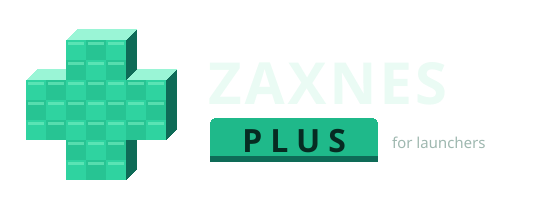

  

# Zaxnes Plus

**Zaxnes Plus** is an Android build of [Zaxnes](https://github.com/nixxou/zaxnes), nixxou's free NES
emulator that plays your games **in 3D**, with a few changes that make it work well with a
launcher or frontend such as
[Game Log Tracker DS Launcher](https://github.com/Gin649/Game-Log-Tracker-DS-Launcher).

Everything else is Zaxnes as nixxou makes it: the 3D scenes, 3dSen profiles, widescreen,
RetroAchievements, save states, shaders and the console interface. For all of that, see the
[Zaxnes README](../README.md).

> **This is a personal fork, not an official Zaxnes release.** It is not affiliated with nixxou,
> Geod Studio or Nintendo. NES is a trademark of Nintendo. If the official Zaxnes gains these
> features, use it instead.

## What Zaxnes Plus adds

- **Games open straight from a launcher.** A launcher or frontend can start a game with Android's
  usual "open this file" request, and Zaxnes Plus goes straight into it instead of opening on its
  ROM list. A game sent while Zaxnes Plus is already running opens there too.
- **Back to your launcher when you quit.** For a game a launcher started, quitting from the in-game
  menu closes Zaxnes Plus and returns to the launcher, like other emulators. Started from its own
  icon, Zaxnes Plus behaves as usual.
- **A profiles folder you can reach.** Android hides an app's own folder from file managers, so
  Zaxnes Plus has a second icon, **Zaxnes Plus profiles**. Pick a folder with it once (for example on
  your SD card) and every new or changed `.3dn` profile in it is copied in each time Zaxnes Plus
  starts. You can also open or share a `.3dn` file with Zaxnes Plus profiles from a file manager.
- **3dSen profiles without converting on a PC.** In **Zaxnes Plus profiles**, choose **Import 3dSen
  profiles…**, pick 3dSen's profile bundle file, and every profile in it is converted on the
  device (see [3D profiles](#3d-profiles)).
- **Installs beside the official Zaxnes.** Zaxnes Plus has its own app ID
  (`io.github.gin649.zaxnes`), so both can be installed at once. Each build installs over the last
  one and keeps your profiles, saves and settings.
- **Kept up to date.** Once a week, Zaxnes Plus brings in what's new in the official Zaxnes and
  builds a new version.

The FlappyZaxNes demo game isn't included: its files are built separately and aren't in the Zaxnes
repository. The two profiles made for Zaxnes (*Faxanadu* and *Metal Force*, from
[zaxnes_3dn](https://github.com/nixxou/zaxnes_3dn)) are included, as in the official builds.

## Download

Get the latest `ZaxnesPlus-…-android-arm64.apk` from the [Releases](https://github.com/Gin649/zaxnes-plus/releases) page and
install it. It needs Android 7.0 or later on 64-bit ARM (phones, tablets and handhelds such as the
AYN Thor).

## Using it with a launcher

In Game Log Tracker DS Launcher, pick **Zaxnes Plus (3D)** as the emulator for NES (and Famicom)
in Launcher settings. Other launchers and frontends can start it like this:

| | |
|---|---|
| Package | `io.github.gin649.zaxnes` |
| Activity | `io.github.nixxou.zaxnes.ZaxnesActivity` |
| Action | `android.intent.action.VIEW` |
| Data | the ROM's `content://` address (with read permission), or a `file://` path |

A `ROM` text extra holding a path or a `content://` address works too. The ROM is copied into the
app's cache under its own file name, so battery saves and save states stay with the same game.

## 3D profiles

Zaxnes doesn't come with 3dSen's profiles: you bring them from your own copy of
[3dSen](https://store.steampowered.com/app/1147940). 3dSen keeps them all packed in one file, and
Zaxnes Plus can convert that file itself:

1. In Steam, right-click 3dSen ▸ **Manage ▸ Browse local files**. In the folder ending in `_Data`,
   open `StreamingAssets/aa/StandaloneWindows64/` and copy the file named
   `defaultprofiles_assets_all_….bundle`.
2. Copy it anywhere on your device (Downloads is fine).
3. Open **Zaxnes Plus profiles** and choose **Import 3dSen profiles…**, then pick the file. Zaxnes
   Plus converts every profile in it and tells you how many were imported; they are used the
   next time a game starts. You can also open or share the file with Zaxnes Plus profiles from a
   file manager. After a 3dSen update, import the new bundle the same way.

The same conversion is **File ▸ Import from 3dSen…** in the desktop Zaxnes, which works too:
its profiles go to `%LOCALAPPDATA%\Zaxnes\profiles`, and `.3dn` files you copy to your folder
are copied in at the next start.

Free community profiles are shared in the
[Profile Repository](https://itch.io/board/872690/profile-repository) of the 3dSen Maker forum;
import them on the PC with **File ▸ Import a profile…**, then copy them over the same way. To make
your own, use [3dSen Maker](https://geod.itch.io/3dsen-maker), Geod Studio's free profile editor.

Without a profile, every game still plays, in 2D or in Zaxnes' default 3D.

## Building

The **Android APK** workflow (Actions tab) builds the APK and publishes it as a release. The
**Catch up with Zaxnes** workflow runs every Monday, merges the official Zaxnes and starts a build;
if an update clashes with the Zaxnes Plus changes, it merges nothing and fails so the clash can be
fixed by hand.

The Zaxnes Plus changes are kept small so they could be offered back to Zaxnes:

| File | What it does |
|---|---|
| `rust/build/android/java/.../ZaxnesActivity.java` | passes a sent game on as `--rom`, and games sent while running |
| `rust/build/android/java/.../LaunchedRom.java` | turns the sent ROM into a file the emulator can open |
| `rust/build/android/java/.../ProfileFolder.java`, `ProfilesActivity.java` | Zaxnes Plus profiles: the 3dSen import and the profiles folder |
| `rust/crates/zax-android/src/lib.rs` | hands the activity's arguments to Zaxnes, and runs the 3dSen import for Zaxnes Plus profiles |
| `rust/crates/zax-app/src/launch_origin.rs` | remembers that a launcher started the game |
| `rust/crates/zax-app/src/application.rs` | opens a game sent while running |
| `rust/crates/zax-app/src/ui/handheld/mod.rs` | quitting goes back to the launcher |
| `rust/crates/zax-app/src/demo_game.rs` | builds without the demo game's files |

## Licence and credits

Zaxnes is © nixxou and free software under the **GNU General Public License v3**
([LICENSE](../LICENSE)); Zaxnes Plus is under the same licence. See the
[Zaxnes README](../README.md#licence-and-credits), [ASSETS-LICENSES.md](../ASSETS-LICENSES.md) and
[THIRD-PARTY-NOTICES.md](../THIRD-PARTY-NOTICES.md) for the full credits. The bundled
[zaxnes_3dn](https://github.com/nixxou/zaxnes_3dn) profiles are under CC BY-NC-ND 4.0.
