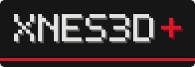

  

# Xnes3D+

**Xnes3D+** is a 3D NES emulator for Android. It plays your NES games in 3D, with an NES-style
interface made for handhelds and controllers. It is built on [Zaxnes](https://github.com/nixxou/zaxnes),
nixxou's free NES emulator, and keeps everything Zaxnes does: the 3D scenes, 3dSen profiles,
widescreen, RetroAchievements and shaders. For those, see the [Zaxnes README](../README.md).

> **Xnes3D+ is a personal project, not an official Zaxnes release.** It is not affiliated with
> nixxou, Geod Studio or Nintendo. NES is a trademark of Nintendo.

## What Xnes3D+ adds

- **Smart 3D for every game.** A game with no 3D profile plays in Smart 3D instead of flat 2D:
  characters stand well out from the scenery, solid ground and walls are thick, distant details
  and backdrops sit further back, sprites the game draws behind the background go behind it, and
  the status bar (score, lives, health) stays a flat, readable panel. It works from what the NES
  itself tells the emulator, so it needs nothing per game. A 3D profile, when there is one, is
  always used instead.
- **An NES look.** Charcoal and black with the console's red stripe, a pixel font (Pixelify Sans),
  big rows and round button hints. One icon: everything is inside the app.
- **Your own folders.** Point the game list at the folder your ROMs are already in, and pick
  where battery saves and save states go, on the internal storage or an SD card, outside
  Android's hidden app folder (**Options ▸ Games and 3D profiles**).
- **RetroArch-style controls.** In a game: **L2** held rewinds, **R2** fast forwards, **R1** saves a
  state, **L1** loads the newest one, and **L3 + R3** (both sticks pressed in) opens the menu.
  Swipe the screen to turn the view, pinch to zoom.
- **15 save states and an auto save.** R1 goes round 15 slots, replacing the oldest. Leaving a
  game writes its own auto save, and starting the game again picks up from there.
- **3D profiles from the menus.** **Options ▸ Games and 3D profiles** imports 3dSen's profiles on
  the device, downloads the community profiles in one tap, and copies profiles from a folder you
  choose (see [3D profiles](#3d-profiles)).
- **Installs beside the official Zaxnes.** Xnes3D+ has its own app ID
  (`io.github.gin649.zaxnes`), so both can be installed at once. Each build installs over the
  last one and keeps your profiles, saves and settings.
- **Kept up to date.** Once a week, Xnes3D+ brings in what's new in Zaxnes and builds a new
  version.

The FlappyZaxNes demo game isn't included: its files are built separately and aren't in the Zaxnes
repository. The two profiles made for Zaxnes (*Faxanadu* and *Metal Force*, from
[zaxnes_3dn](https://github.com/nixxou/zaxnes_3dn)) are included, as in the official builds.

## Download

Get the latest `Xnes3D-…-android-arm64.apk` from the [Releases](https://github.com/Gin649/zaxnes-plus/releases)
page and install it. It needs Android 7.0 or later on 64-bit ARM (phones, tablets and handhelds
such as the AYN Thor).

## 3D profiles

Xnes3D+ doesn't come with 3dSen's profiles: you bring them from your own copy of
[3dSen](https://store.steampowered.com/app/1147940). 3dSen keeps them all packed in one file, and
Xnes3D+ converts that file itself:

1. In Steam, right-click 3dSen ▸ **Manage ▸ Browse local files**. In the folder ending in `_Data`,
   open `StreamingAssets/aa/StandaloneWindows64/` and copy the file named
   `defaultprofiles_assets_all_….bundle`.
2. Copy it anywhere on your device (Downloads is fine).
3. In Xnes3D+, open **Options ▸ Games and 3D profiles ▸ Import 3dSen profiles** and pick the file.
   Every profile in it is converted and shows in your game list a moment later. After a 3dSen
   update, import the new bundle the same way.

Free community profiles are shared in the
[Profile Repository](https://itch.io/board/872690/profile-repository) of the 3dSen Maker forum.
The ones listed in [`community/profiles.json`](../community/profiles.json) come in with **Get
community profiles** (how to add one: [community/README.md](../community/README.md)); others can be
put in your profiles folder, or shared with Xnes3D+ from a file manager. To make your own, use
[3dSen Maker](https://geod.itch.io/3dsen-maker), Geod Studio's free profile editor.

## Starting it from another app

Launchers and frontends can start a game directly:

| | |
|---|---|
| Package | `io.github.gin649.zaxnes` |
| Activity | `io.github.nixxou.zaxnes.ZaxnesActivity` |
| Action | `android.intent.action.VIEW` |
| Data | the ROM's `content://` address (with read permission), or a `file://` path |

Name the activity in the request: Xnes3D+ doesn't list itself in Android's "Open with" choices.

## Building

The **Android APK** workflow (Actions tab) builds the APK and publishes it as a release. The **UI
preview** workflow takes pictures of the interface. The **Catch up with Zaxnes** workflow runs
every Monday, merges the official Zaxnes and starts a build; if an update clashes with the Xnes3D+
changes, it merges nothing and fails so the clash can be fixed by hand. The changes are marked
"Xnes3D+" (or "Zaxnes Plus", the earlier name) in the code.

## Licence and credits

Xnes3D+ is built on Zaxnes, © nixxou, free software under the **GNU General Public License v3**
([LICENSE](../LICENSE)); Xnes3D+ is under the same licence. See the
[Zaxnes README](../README.md#licence-and-credits), [ASSETS-LICENSES.md](../ASSETS-LICENSES.md) and
[THIRD-PARTY-NOTICES.md](../THIRD-PARTY-NOTICES.md) for the full credits. The bundled
[zaxnes_3dn](https://github.com/nixxou/zaxnes_3dn) profiles are under CC BY-NC-ND 4.0. The
interface font is [Pixelify Sans](https://fonts.google.com/specimen/Pixelify+Sans) (SIL Open Font
License).
